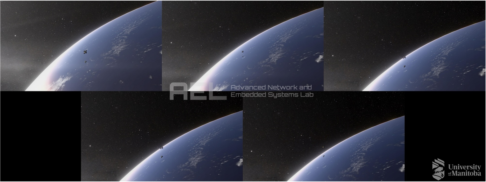

# Space Object Detection Dataset v3.0 (SODv3)

SODv3 is an image dataset for research and evaluation in space object detection.

- Release date: November 20, 2026
- Creators: Xingyu Qu and Peng Hu, Advanced Network and Embedded Systems Lab (AEL)
- Publisher: Dept. of Electrical and Computer Engineering, University of Manitoba, Canada
- Dataset Guide: [Relative path or public link]

*Example from SODv3.*

## Recommended citation

Xingyu Qu and Peng Hu. (2026). Space Object Detection Dataset v3.0 (SODv3).
[Publisher]. [DOI or permanent release URL]

## Related Publications

- Xingyu Qu and Peng Hu, "Detecting Small Space Objects for Space Situational Awareness with Collaborative Edge AI," [arXiv:2611.19394](https://arxiv.org/abs/2611.19394)
- Xingyu Qu, Wenuan Zhang, and Peng Hu, "Collaborative space object detection with multi-satellite viewpoints in LEO constellations," Applied Soft Computing, vol. 204, p. 116741, Jan. 2027. [doi: https://doi.org/10.1016/j.asoc.2026.116741](https://doi.org/10.1016/j.asoc.2026.116741)

## Access and License

To request access to the SODv3 dataset, please complete [the web form](https://forms.cloud.microsoft/Pages/ResponsePage.aspx?id=C92AT4wzTE6KFJBEaWL3uH58ObJG0JRLp0BaD3af9F1UNVBGR09FSFJEMjVNSVM3Q1lCNlk3Qk03Ny4u)

SODv3 is licensed under the Creative Commons Attribution 4.0 International
(CC BY 4.0) license: https://creativecommons.org/licenses/by/4.0/
